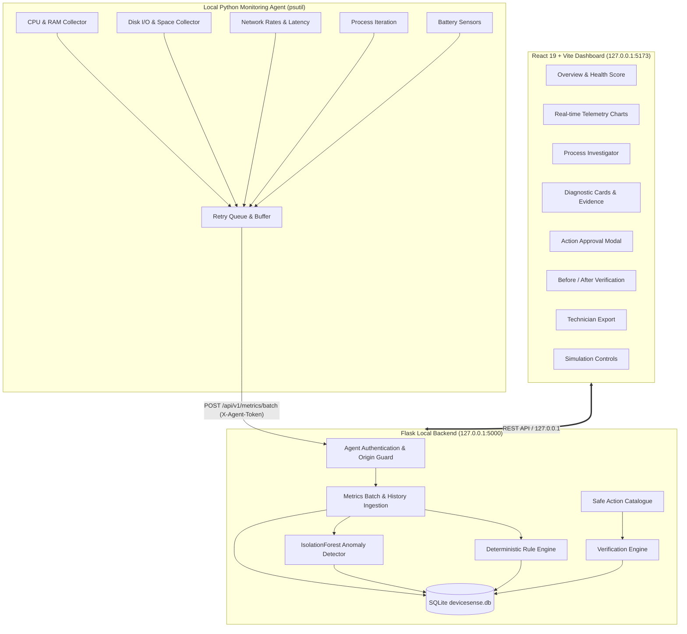

# DeviceSense AI — System Architecture

DeviceSense AI is an evidence-based, local-first Windows PC diagnostic platform. It operates completely on the local loopback interface (`127.0.0.1`) without requiring paid APIs, external cloud connectivity, or intrusive privileges.

## Component Architecture

## Core Components

### 1. Local Python Monitoring Agent (`agent/`)
- Runs as a standard, non-administrator user process.
- Gathers hardware and operating system telemetry using `psutil`.
- Sampling intervals:
  - CPU, RAM, Disk I/O throughput, Network throughput: 2 seconds.
  - Process resource ranking: 5 seconds.
  - Disk capacity & battery sensors: 30 seconds.
  - TCP connect latency to DNS gateway: 15 seconds.
- Computes throughput rates ($MB/s$ or $KB/s$) from the difference between cumulative counters divided by elapsed delta time ($dt$).
- In-memory ring buffer (up to 120 samples) queues data during server outages with exponential backoff.
- Catches and ignores `AccessDenied` errors for system-protected processes without crashing.

### 2. Flask API & Application Logic (`backend/`)
- Strictly bound to `127.0.0.1` (never exposed to `0.0.0.0`).
- Validates all incoming agent submissions with high-entropy HMAC tokens.
- Restricts browser origins to local development endpoints (`http://localhost:5173`).
- Orchestrates the diagnostic loop:
  1. Ingestion of raw samples.
  2. Rolling-window multi-dimensional ML anomaly scoring.
  3. Persistent-threshold rule evaluation.
  4. Generation of structured findings with confidence and action links.
  5. User authorization and verification measurement.

### 3. Database Layer (`backend/app/models/database.py`)
- SQLite persistence using SQLAlchemy ORM.
- Tables:
  - `device`: Device metadata (hostname, OS version, CPU cores, RAM).
  - `monitoring_session`: Tracks monitoring sessions and execution status.
  - `metric_sample`: Time-series telemetry (CPU, RAM, disk, network, latency, processes, anomaly score).
  - `diagnostic`: Active, resolved, and dismissed findings with evidence and root-cause hypotheses.
  - `recommendation`: Allowlisted safe corrective actions.
  - `action_event`: Audit log of approved and rejected operations.
  - `verification`: Pre-vs-post metric comparisons and outcome classifications.

### 4. React + Vite Dashboard (`frontend/`)
- Built with React, Vite, and Recharts.
- Features:
  - Real-time telemetry graphs for CPU, RAM, Disk I/O, Network, and Latency.
  - Process investigator with search and CPU/RAM sorting.
  - Diagnostic cards with calibrated confidence meters and evidence breakdowns.
  - Fix assistant with explicit authorization modals.
  - Verification cards detailing measured improvement or regression.
  - Exportable diagnostic audit reports in JSON and Markdown.
